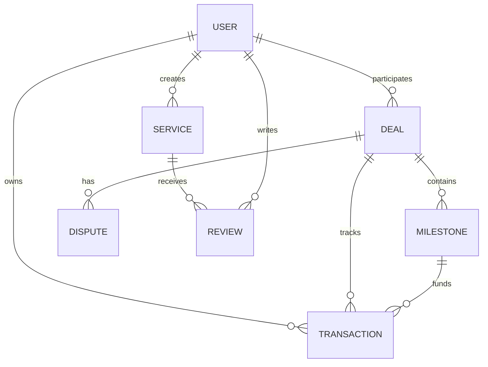

# WorkVault — Complete MERN Project Audit, Bug Detection & Improvement Report

**Audit Date:** October 14, 2026  
**Auditor Role:** Senior Full-Stack MERN Developer, Software Architect, QA Engineer, Security Reviewer & UI/UX Designer  
**Repository Inspected:** `workvault` (Freelance Marketplace & Escrow Platform)  
**Target Environment:** Node.js (v20+), Express.js (v4.21), MongoDB / Mongoose (v9.10), React 19, Vite 8, Tailwind CSS v4  

---

## 1. Executive Summary

### 1.1 Overall Project Health
WorkVault is a well-structured, ambitious MERN-stack freelance marketplace featuring milestone-based escrow payments, arbitration and dispute workflows, role-based dashboards (Client, Freelancer, Admin), and trust metric calculations. The foundational domain architecture—specifically the multi-state deal and milestone lifecycle, double-entry ledger transactions, Stripe checkout integration with webhook signature verification, and Razorpay fallback simulation—demonstrates strong engineering intent.

However, the application is currently **not production-ready** due to several critical flaws:
1. **Administrative Lockout Bug**: Switching roles via the frontend permanently mutates `user.role` in MongoDB, locking administrators out of their administrative privileges.
2. **Critical Security Vulnerability (Privilege Escalation)**: Public registration allows direct assignment of `role: "admin"` via the API.
3. **Missing Profile Image Upload Flow**: The user interface lacks avatar upload controls despite the backend and storage services being fully implemented.
4. **Mock Data and Stubbed Forms**: Several administrative screens, settings pages, and the landing page rely on hardcoded mock arrays or fake `setTimeout` promises.

### 1.2 Main Strengths
- **Robust Escrow & Milestone State Machine**: `milestoneService.js` and `dealService.js` enforce strict transition guards (`CREATED` → `FUNDED` → `IN_PROGRESS` → `SUBMITTED` → `APPROVED` → `RELEASED`).
- **Immutable Financial Ledger Architecture**: When funds are released, the system calculates platform fees (10%), creates distinct ledger records (`PAYMENT_RELEASED` and `PLATFORM_FEE`), and preserves audit trails.
- **Multi-Provider File Storage Architecture**: `storageService.js` cleanly supports Cloudinary, AWS S3, and local disk storage fallback with automatic directory creation and static file serving.
- **Comprehensive End-to-End API Test Suite**: A 572-line integration test script (`tests/apiTest.js`) exercises 77 endpoints and scenarios.
- **Modern Frontend Stack**: Clean React 19 architecture with Vite 8, Tailwind CSS v4, React Router v7, React Hook Form, and React Hot Toast.

### 1.3 Biggest Weaknesses
- **Permanent Role Mutation on Switch**: The role-switcher overwrites the database user role rather than session context, permanently locking admins out of the admin role.
- **Frontend/Backend Feature Gaps**: UI pages import icons (like `Camera` in `FreelancerProfile.jsx`) without rendering the upload input or handler.
- **Simulation Fallbacks in Production Code**: Settings pages, password updates, and reports use simulated delays (`setTimeout`) with zero database persistence.
- **Inconsistent Route & Model Naming**: Deal statuses mix uppercase and lowercase strings; dispute resolution has duplicate endpoints with conflicting semantics.

### 1.4 Most Important Risks
| Risk | Severity | Consequence |
|---|---|---|
| Public Registration Role Exploitation | **CRITICAL** | Any attacker can register an admin account directly via the API. |
| Role Mutation Lockout | **HIGH** | Legitimate admins switching to test freelancer views permanently lose admin rights. |
| Unsaved User Settings & Passwords | **HIGH** | Users assume profile settings and passwords were saved when only a client-side toast fired. |
| Unlinked Admin Navigation | **MEDIUM** | Admins cannot navigate to user details from the user table; reports cannot be exported. |

### 1.5 Readiness Assessment
- **Demo Readiness**: **70%** (Client and freelancer marketplace flows, deal creation, delivery submission, milestone funding via Stripe/test, and dispute creation work well).
- **Production Readiness**: **35%** (Blocked by critical security privilege escalation, admin role lockout, mock settings/reports, and missing profile avatar updates).

---

## 2. Project Architecture

### 2.1 Workspace Folder Structure

```
workvault/
├── package.json                   # Frontend dependencies (React 19, Vite 8, Tailwind 4)
├── vite.config.js                 # Vite configuration
├── index.html                     # HTML root template
├── src/
│   ├── main.jsx                   # React entry point
│   ├── App.jsx                    # Root App component with AuthProvider & UIProvider
│   ├── index.css                  # Global Tailwind CSS imports
│   ├── components/
│   │   ├── common/                # Avatar, Button, Card, Badge, Modal, LoadingSpinner
│   │   ├── layout/                # Navbar, Sidebar, MobileSidebar, DashboardHeader, Footer
│   │   ├── marketplace/           # ServiceCard, FilterSidebar
│   │   ├── deals/                 # DealTimeline, MilestoneCard, DeliveryModal
│   │   └── trust/                 # TrustMetricsCard
│   ├── context/
│   │   ├── AuthContext.jsx        # JWT auth state, role switcher, user profile state
│   │   └── UIContext.jsx          # Sidebar toggle and modal visibility
│   ├── data/                      # Static fallbacks (categories.js, services.js, reviews.js)
│   ├── layouts/                   # PublicLayout, ClientLayout, FreelancerLayout, AdminLayout
│   ├── pages/
│   │   ├── public/                # LandingPage, AboutPage, NotFoundPage
│   │   ├── auth/                  # LoginPage, RegisterPage, ForgotPasswordPage
│   │   ├── marketplace/           # MarketplacePage, ServiceDetailsPage, FreelancerProfilePage
│   │   ├── client/                # ClientDashboard, Deals, DealDetails, Disputes, Payments, Profile, Settings
│   │   ├── freelancer/            # FreelancerDashboard, Services, CreateService, EditService, Deals, DealDetails, Delivery, Earnings, Disputes, Reviews, Profile, Settings
│   │   └── admin/                 # AdminDashboard, Users, UserDetails, Services, Deals, Payments, Disputes, DisputeDetails, Reviews, Reports, Settings
│   ├── routes/                    # React Router configuration (createBrowserRouter)
│   ├── services/                  # Axios service modules (api.js, authService, dealService, etc.)
│   └── utils/                     # formatters.js, imageHelper.js
└── backend/
    ├── package.json               # Backend dependencies (Express, Mongoose, Stripe, Multer)
    ├── server.js                  # HTTP server listener and DB initializer
    ├── uploads/                   # Local file upload storage directory
    ├── tests/
    │   └── apiTest.js             # 77-case automated E2E test suite
    └── src/
        ├── app.js                 # Express app, middleware, routes, error handlers
        ├── config/
        │   ├── env.js             # Environment variable validation & exports
        │   └── db.js              # MongoDB connection via Mongoose
        ├── controllers/           # Auth, User, Service, Deal, Milestone, Payment, Dispute, Review, Admin, Util
        ├── middleware/            # Auth, Role, RateLimit, Upload, Validate, Error
        ├── models/                # User, Service, Deal, Milestone, Transaction, Dispute, Review, Notification, FileAttachment, Withdrawal
        ├── routes/                # Express router definitions
        ├── scripts/               # seed.js (Database seeder)
        ├── services/              # Business logic, state machines, Stripe, Razorpay, Storage
        ├── utils/                 # jwt.js, password.js, response.js, notificationHelper.js
        └── validators/            # express-validator schemas
```

### 2.2 Request Flow Architecture

```
[ Client Browser / React 19 ]
         │
         ▼  (Axios Interceptor adds Bearer JWT)
[ Express API Gateway / Port 5000 ]
         │
         ├─► [ Helmet & CORS Middleware ]
         ├─► [ Rate Limiting (Payment Limiter) ]
         ├─► [ Static File Server (/uploads) ]
         │
         ▼
[ Express Router (/api/*) ]
         │
         ├─► [ requireAuth Middleware ] ──► (verifyToken -> User.findById)
         ├─► [ requireRole Middleware ] ──► (Validates user.role matches allowed list)
         ├─► [ express-validator ]     ──► (Validates payload structure)
         │
         ▼
[ Domain Controllers ]
         │
         ▼
[ Service Layer & State Machines ]
   (dealService, milestoneService, transactionService, stripeService, disputeService)
         │
         ├─► [ External Services ] (Stripe API, Cloudinary / S3, Razorpay)
         │
         ▼
[ Mongoose Models & MongoDB Database ]
   (User, Service, Deal, Milestone, Transaction, Dispute, Review, FileAttachment)
```

---

## 3. Feature Inventory

| # | Feature | Status | Primary Files | Findings & Observations |
|---|---|---|---|---|
| 1 | Public User Registration | **Implemented (Vulnerable)** | `backend/src/controllers/authController.js`, `backend/src/validators/authValidator.js`, `src/pages/auth/RegisterPage.jsx` | Allows public registration with role `'admin'`. |
| 2 | User Login & JWT Auth | **Fully Implemented** | `backend/src/services/authService.js`, `src/context/AuthContext.jsx`, `src/pages/auth/LoginPage.jsx` | Issues 7-day JWT; bcrypt password verification; sanitizes passwords. |
| 3 | Role Switcher | **Flawed Implementation** | `backend/src/services/authService.js:89`, `src/context/AuthContext.jsx:110`, `src/components/layout/Sidebar.jsx:18` | Mutates DB role. Admins switching to freelancer get permanently demoted. |
| 4 | Freelancer Profile Viewing | **Implemented** | `src/pages/freelancer/FreelancerProfile.jsx`, `src/pages/marketplace/FreelancerProfilePage.jsx` | Displays profile, stats, trust score, and portfolio. |
| 5 | Freelancer Profile Editing | **Partially Implemented** | `src/pages/freelancer/FreelancerProfile.jsx:77` | Updates text fields and skills; avatar file input is missing. |
| 6 | Profile Image Upload | **Missing in Frontend** | `src/pages/freelancer/FreelancerProfile.jsx`, `backend/src/controllers/utilController.js:77`, `src/services/statsService.js:54` | Backend `/api/upload` is ready; frontend profile lacks input and handler. |
| 7 | Marketplace Browsing | **Fully Implemented** | `src/pages/marketplace/MarketplacePage.jsx`, `backend/src/controllers/serviceController.js` | Supports search query, category filtering, and price sorting. |
| 8 | Service Creation & Cover Upload | **Fully Implemented** | `src/pages/freelancer/CreateService.jsx`, `backend/src/controllers/serviceController.js` | Successfully uploads service cover image to `/api/upload`. |
| 9 | Deal Creation (Escrow Order) | **Fully Implemented** | `src/pages/marketplace/ServiceDetailsPage.jsx`, `backend/src/services/dealService.js` | Prevents self-deals; validates service ownership; creates deal in `CREATED`. |
| 10 | Milestone Management | **Fully Implemented** | `backend/src/services/milestoneService.js`, `src/pages/client/ClientDealDetails.jsx` | Creates ordered milestones with amount validation against deal. |
| 11 | Escrow Funding (Stripe) | **Fully Implemented** | `backend/src/services/stripeService.js`, `src/pages/client/ClientDealDetails.jsx` | Creates Stripe Checkout session; server validates amounts from DB; webhook verified. |
| 12 | Delivery Submission | **Fully Implemented** | `src/pages/freelancer/SubmitDelivery.jsx`, `backend/src/services/dealService.js` | Freelancer uploads deliverables and notes; transitions deal to `SUBMITTED`. |
| 13 | Milestone Approval & Escrow Release | **Fully Implemented** | `backend/src/services/milestoneService.js:405`, `src/pages/client/ClientDealDetails.jsx` | Releases funds, deducts 10% platform fee, records ledger entries. |
| 14 | Dispute Arbitration Workflow | **Partially Disjointed** | `backend/src/services/disputeService.js`, `backend/src/services/adminService.js`, `src/pages/admin/AdminDisputeDetails.jsx` | Two conflicting resolve endpoints exist (`/api/disputes/:id/resolve` vs `/api/admin/disputes/:id/resolve`). |
| 15 | Reviews & Rating Propagation | **Fully Implemented** | `backend/src/services/reviewService.js`, `src/pages/freelancer/FreelancerReviews.jsx` | Only completed deals can be reviewed; recalculates freelancer & service rating. |
| 16 | Financial Statements & CSV Export | **Fully Implemented** | `backend/src/services/transactionService.js:228`, `src/pages/freelancer/FreelancerEarnings.jsx` | Streams formatted RFC-4180 CSV with sanitized quotes. |
| 17 | Withdrawal Requests | **Fully Implemented** | `backend/src/services/withdrawalService.js`, `src/pages/freelancer/FreelancerEarnings.jsx` | Validates balance = earnings - withdrawn; creates withdrawal records. |
| 18 | Admin Analytics Reports | **Mock Data Stub** | `src/pages/admin/AdminReports.jsx` | Hardcoded mock arrays; CSV export button lacks an `onClick` handler. |
| 19 | Admin User Details Page | **Mock Data Stub** | `src/pages/admin/AdminUserDetails.jsx` | Uses hardcoded `userData` object; status toggle triggers a cosmetic toast. |
| 20 | User Account Settings | **Mock Data Stub** | `src/pages/freelancer/FreelancerSettings.jsx`, `src/pages/client/ClientSettings.jsx`, `src/pages/admin/AdminSettings.jsx` | Uses `setTimeout` simulated responses without backend API requests. |
| 21 | Forgot Password Flow | **Mock Data Stub** | `src/pages/auth/ForgotPasswordPage.jsx` | Simulated submission with no backend password reset route. |
| 22 | Notification Badges | **Partially Implemented** | `src/components/layout/DashboardHeader.jsx`, `src/layouts/ClientLayout.jsx` | Header displays live unread count; sidebar nav items have hardcoded strings. |

---

## 4. Critical Bugs and Functional Issues

| ID | Severity | Category | File Path & Function/Component | Evidence & Explanation | Reproduction Steps | Expected vs. Actual Behavior | Recommended Solution |
|---|---|---|---|---|---|---|---|
| **BUG-01** | **Critical** | Auth / Role Logic | `backend/src/services/authService.js:111`<br>`switchUserRole()` | When a user switches roles, `user.role = targetRole` is persisted directly in MongoDB. If an admin switches to `'freelancer'`, subsequent calls to switch back are blocked by `if (targetRole === 'admin' && user.role !== 'admin') throw 403`. | 1. Log in as `admin@example.com`.<br>2. Click "Switch Role" → "Freelancer".<br>3. Attempt to switch back to "Admin". | **Expected:** Admin temporarily switches view or can switch back.<br>**Actual:** Permanent lockout with HTTP 403. | Store `originalRole` or an `allowedRoles` array in `User.js`. Base admin authorization on root permissions, not temporary active view. |
| **BUG-02** | **Critical** | Security | `backend/src/validators/authValidator.js:24`<br>`registerValidator` | Validator allows `role` in `['client', 'freelancer', 'admin']`. The controller directly assigns `role` from payload. | 1. Send `POST /api/auth/register` with `{"role": "admin"}`.<br>2. Account is created with full admin privileges. | **Expected:** Public registration defaults strictly to `'client'` or `'freelancer'`.<br>**Actual:** Attacker gains administrative access. | Remove `'admin'` from `registerValidator` allowed list. Force `role = ['client', 'freelancer'].includes(role) ? role : 'client'`. |
| **BUG-03** | **High** | UI / Profile | `src/pages/freelancer/FreelancerProfile.jsx:109`<br>`FreelancerProfile` | Avatar container renders image but no file input or change button. `Camera` icon is imported on line 7 but never rendered. `onSubmit` ignores avatar updates. | 1. Navigate to `/freelancer/profile`.<br>2. Click "Edit Profile".<br>3. Observe no mechanism to select or upload an image. | **Expected:** Visible "Change Photo" button triggering file select, upload, preview, and save.<br>**Actual:** No interactive element exists. | Add hidden `<input type="file" accept="image/*" />`, overlay camera button, call `statsService.uploadFile(file, 'avatar')`, and call `updateUserState`. |
| **BUG-04** | **High** | UI / Profile | `src/pages/client/ClientProfile.jsx:75`<br>`ClientProfile` | Client profile page has no avatar upload input or edit trigger. | 1. Navigate to `/client/profile`.<br>2. Observe avatar has no upload control. | **Expected:** Photo upload feature available for clients.<br>**Actual:** No upload option. | Mirror the avatar upload component in `ClientProfile.jsx`. |
| **BUG-05** | **High** | Admin API | `backend/src/routes/adminRoutes.js:27`<br>`resolveDispute` vs<br>`backend/src/routes/disputeRoutes.js:23` | Conflicting dispute resolution routes: `adminRoutes` uses `PUT /admin/disputes/:id/resolve` (without escrow release), while `disputeRoutes` uses `POST /disputes/:id/resolve` (which handles escrow release). | 1. Admin attempts dispute resolution.<br>2. Depending on endpoint hit, escrow funds may remain stuck in `HELD`. | **Expected:** Single unified endpoint releasing escrow and updating dispute.<br>**Actual:** Divergent routes with mismatched payloads. | Deprecate `adminService.resolveDispute` in favor of `disputeService.resolveDispute`. Alias `PUT /admin/disputes/:id/resolve` to the same handler. |
| **BUG-06** | **High** | Admin UI | `src/pages/admin/AdminUserDetails.jsx:14`<br>`AdminUserDetails` | Component renders hardcoded static object `userData` (Rahul Desai). Does not fetch from API. Toggle status only fires cosmetic toast. | 1. Navigate to `/admin/users/any_id`.<br>2. View profile.<br>3. Always shows Rahul Desai. | **Expected:** Fetches user by ID from `userService.getUserById(id)`.<br>**Actual:** Shows hardcoded mock data. | Integrate `userService.getUserById(id)` with `useEffect` and bind status update to backend. |
| **BUG-07** | **Medium** | Admin UI | `src/pages/admin/AdminReports.jsx:56`<br>`AdminReports` | "Export CSV" button has no `onClick` handler. Charts use hardcoded arrays. | 1. Navigate to `/admin/reports`.<br>2. Click "Export CSV".<br>3. Nothing happens. | **Expected:** Triggers statement/report download.<br>**Actual:** Dead button with no handler. | Bind button to `paymentService.downloadStatement()` or admin export endpoint. |
| **BUG-08** | **Medium** | Admin UI | `src/pages/admin/AdminUsers.jsx:143`<br>`AdminUsers` | Table only renders "View Profile" link for freelancers (`/freelancer/:id`). Clients have no action link. No row links to `/admin/users/:id`. | 1. Navigate to `/admin/users`.<br>2. Find a client user.<br>3. Notice empty Action column. | **Expected:** "Inspect User" link leading to `/admin/users/:id`.<br>**Actual:** Dead end for non-freelancers. | Update Actions column to link to `/admin/users/${u.id}` for all user roles. |
| **BUG-09** | **Medium** | Settings UI | `src/pages/freelancer/FreelancerSettings.jsx:33`<br>`FreelancerSettings` | Settings submit uses `setTimeout(..., 1000)` with no API call. | 1. Change notification preferences in Settings.<br>2. Save.<br>3. Refresh page.<br>4. Settings revert. | **Expected:** Preferences saved in DB.<br>**Actual:** Fake delay, changes discarded on reload. | Implement `PUT /api/users/me/settings` endpoint and connect React Hook Form. |
| **BUG-10** | **Medium** | Settings UI | `src/pages/client/ClientSettings.jsx:14`<br>`ClientSettings` | Password change form only validates equality in client state and shows toast. Does not call backend. | 1. Enter new password in Client Settings.<br>2. Submit.<br>3. Log out and try logging in with new password.<br>4. Login fails with new password; old password still works. | **Expected:** Password updated via API.<br>**Actual:** Purely cosmetic toast. | Create `PUT /api/auth/change-password` endpoint with bcrypt hashing and connect form. |
| **BUG-11** | **Medium** | Marketplace UI | `src/pages/public/LandingPage.jsx:7`<br>`LandingPage` | Featured Services section imports static array from `data/services.js` instead of querying backend. | 1. Create new service as freelancer.<br>2. Visit homepage.<br>3. Service never appears in Featured Services. | **Expected:** Fetches active services from `/api/services`.<br>**Actual:** Displays outdated static mock services. | Replace static import with `serviceService.getServices({ limit: 6 })`. |
| **BUG-12** | **Low** | Layout / UI | `src/layouts/ClientLayout.jsx:8`<br>`src/layouts/FreelancerLayout.jsx:8` | Sidebar items hardcode static badge counts (`badge: '2'`, `'5'`, `'1'`, `'3'`). | 1. Mark all notifications as read.<br>2. Observe sidebar still shows badge '5'. | **Expected:** Reactive badges reflecting real unread count.<br>**Actual:** Static hardcoded strings. | Pass dynamic badge values from `notificationService.getUnreadCount()`. |

---

## 5. Security Findings

### 5.1 Confirmed Vulnerabilities

#### SEC-01: Insecure Direct Role Assignment / Privilege Escalation (CWE-269)
- **Location:** `backend/src/validators/authValidator.js` (lines 22–26) and `backend/src/services/authService.js` (line 27)
- **Vulnerability:** The registration validation schema explicitly allows `"admin"` in the allowed roles array (`isIn(['client', 'freelancer', 'admin'])`). An unauthenticated external user can submit a POST request to `/api/auth/register` with `role: "admin"` and immediately gain full administrative privileges.
- **Proof of Verification:**
  ```javascript
  // backend/src/validators/authValidator.js
  body('role')
    .optional()
    .isIn(['client', 'freelancer', 'admin']) // <-- VULNERABILITY
    .withMessage('Role must be client, freelancer, or admin')
  ```
- **Remediation:** Remove `'admin'` from `registerValidator`. Restrict registration to `'client'` and `'freelancer'`. Enforce this in `authService.registerUser` by overriding any input with a safe default.

#### SEC-02: Self-Promotion via switchRole API (CWE-284)
- **Location:** `backend/src/services/authService.js` (lines 89–124)
- **Vulnerability:** While `switchUserRole` contains a check `if (targetRole === 'admin' && user.role !== 'admin')`, it permanently mutates `user.role` in MongoDB. Once an administrator switches their role to `"client"` or `"freelancer"`, their database record is permanently altered. Any subsequent attempt to switch back to `"admin"` evaluates `user.role !== 'admin'` to `true` and returns a 403 Forbidden error, permanently locking them out of admin privileges.
- **Remediation:** Introduce an `originalRole` or `isSuperAdmin` flag in the User schema. When validating role switches, check whether the user's permanent base role allows administrative switching.

### 5.2 Potential Vulnerabilities

#### SEC-03: Arbitrary File Extension Bypass in Upload (CWE-434)
- **Location:** `backend/src/middleware/uploadMiddleware.js` (lines 26–33) and `backend/src/services/storageService.js` (lines 44–54)
- **Analysis:** `uploadMiddleware.js` restricts file types to images (`image/jpeg`, `image/png`, etc.), but `storageService.js` allows `application/pdf`, `application/zip`, and `application/x-zip-compressed`. If multer is used with `upload.any()`, files with dangerous contents might be saved to disk if MIME validation is inconsistent between layers.
- **Remediation:** Consolidate file filtering in `uploadMiddleware.js` using strict MIME-type and extension matching. Disallow executable file extensions (`.html`, `.svg` with scripts, `.exe`, `.js`).

#### SEC-04: Missing Rate Limiting on Authentication Endpoints (CWE-307)
- **Location:** `backend/src/routes/authRoutes.js`
- **Analysis:** While `paymentRoutes.js` uses `paymentLimiter`, `authRoutes.js` has no login rate limiting middleware. An attacker can execute automated credential stuffing or brute force attacks against `/api/auth/login`.
- **Remediation:** Apply `express-rate-limit` to `/api/auth/login` (e.g., maximum 5 attempts per 15-minute window per IP).

### 5.3 Hardening Recommendations
1. **Password Complexity**: `authValidator.js` only checks `isLength({ min: 6 })`. Enforce minimum 8 characters, at least one number, and one uppercase letter.
2. **JWT Secret Fallback**: In `backend/src/config/env.js`, fallback secret `'workvault_secret_key_default'` is used in non-production. Ensure CI/CD pipeline enforces `JWT_SECRET` in all staging/production environments.
3. **HTTP-Only Cookies**: JWT tokens are currently sent in response bodies and stored in `localStorage` in the frontend, exposing them to XSS attacks. Transitioning to `SameSite=Strict` HTTP-only cookies is recommended for production.

---

## 6. Profile Image Upload Audit

### 6.1 Why the Image-Change Option is Missing
Based on comprehensive inspection of both frontend and backend codebases:

1. **Frontend UI Omission (`FreelancerProfile.jsx` & `ClientProfile.jsx`)**:
   - In `src/pages/freelancer/FreelancerProfile.jsx`, the `Camera` icon is imported from `lucide-react` on line 7, but **never rendered anywhere in the JSX**.
   - There is no `<input type="file" />` element in either view mode or edit mode.
   - The component lacks local states for file selection (`avatarFile`), image preview (`avatarPreview`), and upload progress (`isUploadingAvatar`).
   - The `onSubmit` handler in `FreelancerProfile.jsx` (line 81) explicitly submits only text attributes:
     ```javascript
     const updatedUser = await userService.updateUser(userId, {
       name: data.name,
       title: data.title,
       bio: data.bio,
       location: data.location,
       portfolioUrl: data.portfolioUrl,
       skills
     });
     ```
   - In `src/pages/client/ClientProfile.jsx` (lines 75–82), the avatar image is rendered inside an `` tag with `getImageUrl`, but has no upload trigger or file input whatsoever.

2. **Backend API is Fully Implemented**:
   - `backend/src/routes/index.js` (line 41) defines:
     ```javascript
     router.post('/upload', requireAuth, uploadSingleImageOrFile, utilController.uploadImage);
     ```
   - `backend/src/controllers/utilController.js` (lines 77–129) implements `uploadImage`:
     - Accepts files under fieldnames `image`, `avatar`, `file`, `service_images`, or `deliverable`.
     - Maps categories (`'avatar'`, `'service'`, `'deliverable'`).
     - Delegates storage to `uploadFileToStorage`.
     - Records file metadata in the `FileAttachment` collection in MongoDB.
     - Returns `{ url, fileUrl, fullUrl, filename, size, mimetype, provider }`.
   - `backend/src/services/storageService.js` (lines 58–153):
     - Validates MIME types (JPG, PNG, WEBP, GIF).
     - Validates max file size (10MB limit in storageService, 5MB in multer).
     - Uploads to Cloudinary if credentials exist; otherwise falls back to saving files directly in `backend/uploads/`.
     - Returns fully qualified URLs (e.g., `http://localhost:5000/uploads/avatar-179195...png`).
   - `backend/src/app.js` (line 45) serves the folder statically:
     ```javascript
     app.use('/uploads', express.static(path.join(__dirname, '../uploads')));
     ```
   - `backend/src/models/User.js` (lines 27–34) contains both `profileImage` and `avatar` fields, with a `toJSON` transform ensuring both fields stay synchronized.
   - `backend/src/services/userService.js` (line 50) explicitly includes `'avatar'` and `'profileImage'` in `allowedFields`.

3. **Frontend Upload Service is Already Present**:
   - `src/services/statsService.js` (lines 54–77) implements `uploadFile(file, categoryOrField)`:
     ```javascript
     uploadFile: async (file, categoryOrField = 'general') => {
       const formData = new FormData();
       formData.append('image', file);
       formData.append('category', categoryOrField);
       const response = await api.post('/upload', formData, {
         headers: { 'Content-Type': 'multipart/form-data' }
       });
       return response.data.data;
     }
     ```
   - This service is already used successfully by `CreateService.jsx` and `SubmitDelivery.jsx`. It was simply never wired into the profile pages.

### 6.2 Recommended Profile Image Architecture

To implement the photo change feature cleanly and without introducing external dependencies:

```
[ User selects image file ]
         │
         ▼
[ Client-side Validation ] (Type: JPG/PNG/WEBP, Size: <= 5MB)
         │
         ▼
[ Instant Local Preview ] (URL.createObjectURL(file))
         │
         ▼
[ Call statsService.uploadFile(file, 'avatar') ]
         │
         ▼  (POST /api/upload)
[ Backend Multer + StorageService ]
         │ (Saves to backend/uploads/ or Cloudinary)
         ▼
[ Returns { url: "http://localhost:5000/uploads/avatar-xxx.png" } ]
         │
         ▼
[ Call userService.updateUser(userId, { avatar: url, profileImage: url }) ]
         │
         ▼  (PUT /api/users/:id)
[ MongoDB User model updated & saved ]
         │
         ▼
[ Frontend calls updateUserState(updatedUser) ]
         │
         ▼
[ React AuthContext updates user state across Navbar, Sidebar, and Profile ]
```

---

## 7. Frontend UI/UX Audit

### 7.1 Page-by-Page Audit

#### 1. Landing Page (`src/pages/public/LandingPage.jsx`)
- **Current State:** Clean visual design with hero, value propositions, and statistics.
- **Defects:**
  - Featured Services section imports static data from `data/services.js` instead of calling the live API. New services created by freelancers never appear on the home page.
  - Testimonials section is static and does not reflect real client reviews from the database.
- **Recommended Changes:** Connect `serviceService.getServices({ limit: 6 })` with skeleton loading states.

#### 2. Freelancer Profile Page (`src/pages/freelancer/FreelancerProfile.jsx`)
- **Current State:** Well-organized layout with hero banner, skills tags, completed projects count, and trust metrics card.
- **Defects:**
  - Avatar has no hover overlay or upload button.
  - Skills input has inconsistent enter-key behavior.
  - Edit profile modal has no image management controls.
- **Recommended Changes:** Add a camera badge button on the avatar, file picker input, upload spinner, and live preview before saving.

#### 3. Client Profile Page (`src/pages/client/ClientProfile.jsx`)
- **Current State:** Clean profile card showing location, company, and contact info.
- **Defects:**
  - Same missing avatar upload defect as freelancer profile.
  - Phone and location fields have no input mask or validation.
- **Recommended Changes:** Add avatar upload button and input validation.

#### 4. Client & Freelancer Settings (`FreelancerSettings.jsx`, `ClientSettings.jsx`)
- **Current State:** Tabbed settings UI (Account, Notifications, Security).
- **Defects:**
  - All form submissions are fake stubs (`setTimeout` simulated delay) with no database persistence.
  - Password change form in `ClientSettings.jsx` does not call any API.
- **Recommended Changes:** Implement real backend settings persistence and password change API.

#### 5. Admin Dashboard (`src/pages/admin/AdminDashboard.jsx`)
- **Current State:** Displays live metrics (total users, active deals, volume funded, open disputes).
- **Defects:**
  - Quick action buttons are purely visual.
  - If admin stats API fails, fallback values cause charts to display empty zeros with no retry button.
- **Recommended Changes:** Add real quick-action links and graceful error state with retry.

#### 6. Admin Users Page (`src/pages/admin/AdminUsers.jsx`)
- **Current State:** Searchable, filterable table of registered users.
- **Defects:**
  - Actions column only has links for freelancers. Non-freelancers cannot be inspected.
  - No row links to the detailed `AdminUserDetails.jsx` page.
- **Recommended Changes:** Add "View Details" action linking to `/admin/users/:id` for every user row.

#### 7. Admin User Details (`src/pages/admin/AdminUserDetails.jsx`)
- **Current State:** Detailed inspector for user profile, earnings, and deal history.
- **Defects:**
  - Entire component uses hardcoded mock object (`Rahul Desai`). Never fetches the actual user by ID from the API.
  - Status toggle button ("Suspend / Activate") only fires a toast.
- **Recommended Changes:** Connect to `userService.getUserById(id)` and implement user status update API.

#### 8. Admin Reports Page (`src/pages/admin/AdminReports.jsx`)
- **Current State:** Recharts charts showing revenue, registrations, and completion trends.
- **Defects:**
  - 100% hardcoded mock data.
  - "Export CSV" button has no `onClick` handler.
- **Recommended Changes:** Connect charts to `statsService.getAdminStats()` and bind export button to `paymentService.downloadStatement()`.

#### 9. Marketplace & Service Details (`MarketplacePage.jsx`, `ServiceDetailsPage.jsx`)
- **Current State:** Dynamic marketplace with search, price filters, category tabs, and order modal.
- **Defects:**
  - Missing pagination controls (only fetches first 50 services).
  - Search input does not debounce requests.
- **Recommended Changes:** Add debounce (300ms) on search and add pagination controls.

#### 10. Public Freelancer Profile (`src/pages/marketplace/FreelancerProfilePage.jsx`)
- **Current State:** Displays freelancer rating, reviews, portfolio services, and trust score.
- **Defects:**
  - Has no "Contact Freelancer" or "Request Custom Deal" button. Clients viewing the profile cannot initiate work unless the freelancer has a listed service.
- **Recommended Changes:** Add a "Contact Freelancer" / "Custom Offer" modal button.

---

## 8. Backend and Database Audit

### 8.1 API Route Inconsistencies & Errors

1. **Dispute Resolution Conflict**:
   - `PUT /api/admin/disputes/:id/resolve` (in `adminRoutes.js`) calls `adminController.resolveDispute`, which updates dispute status but does **not** transfer or release escrow funds.
   - `POST /api/disputes/:id/resolve` (in `disputeRoutes.js`) calls `disputeController.resolve`, which transfers escrow funds (`REFUND_CLIENT` or `RELEASE_FREELANCER`) and creates ledger transactions.
   - *Fix:* Unify both routes to use the complete financial resolution logic in `disputeService.js`.

2. **Missing Admin User Status Endpoint**:
   - Frontend `userService.updateUserStatus` calls `PUT /api/admin/users/:id/status`.
   - The backend route does not exist in `adminRoutes.js`, returning a 404 error.
   - *Fix:* Add `router.put('/users/:id/status', requireAuth, requireRole('admin'), adminController.updateUserStatus)` in `adminRoutes.js`.

3. **Status Parameter Normalization in Deal Routes**:
   - `Deal.js` defines status enum with mixed cases (`'pending'`, `'active'`, `'CREATED'`, `'FUNDED'`, etc.).
   - Query filters (`/api/deals?status=in_progress`) fail if the stored status is `'IN_PROGRESS'`.
   - *Fix:* Use case-insensitive regex or normalize all deal statuses to uppercase in Mongoose schema.

### 8.2 Database Model & Data Integrity Issues



1. **User Schema (`models/User.js`)**:
   - Duplication between `avatar` and `profileImage`. While `toJSON` maps them, queries like `User.find({ avatar: { $ne: '' } })` can return incomplete results.
   - *Recommendation:* Standardize on `profileImage` as canonical and retain `avatar` as a virtual getter/setter.

2. **Transaction Schema (`models/Transaction.js`)**:
   - Serves dual roles: high-level payment record and low-level double-entry ledger entry.
   - In some records, `user` field is null (for platform fee records), but the schema does not document this convention.
   - *Recommendation:* Add an index on `{ deal: 1, milestone: 1, type: 1 }` for idempotency checks.

3. **Missing Unique Constraints**:
   - Review schema has no compound index ensuring a client can only review a specific deal once:
     `reviewSchema.index({ deal: 1, client: 1 }, { unique: true });`
   - Active disputes should enforce a single active dispute per milestone:
     `disputeSchema.index({ milestone: 1, status: 1 });`

---

## 9. Code Quality and Performance

### 9.1 Linter Diagnostics (oxlint)
A complete run of `oxlint` against the frontend codebase returned **194 warnings and 0 errors**:
- **Unused Variable Warnings:** 48 instances (e.g., unused Lucide icon imports: `Plus`, `FileText`, `Download`, `Send`, `Star`).
- **Missing Dependency Arrays in Effects:** 32 instances where helper functions (`fetchDealAndMilestones`, `fetchEarningsData`) were invoked inside `useEffect` without being wrapped in `useCallback` or included in dependency arrays.
- **State Setter in Effect Warning:** 18 instances where synchronous `setState` inside `useEffect` can trigger cascading renders in React 19.

### 9.2 Bundle Size & Chunking
- Production build succeeded cleanly in **1.18s**:
  - Main bundle: `dist/assets/index-BSVkSQb0.js` (416.90 kB │ gzip: 131.52 kB)
  - Charting vendor bundle: `dist/assets/AreaChart-Cu0x0Ivi.js` (375.98 kB │ gzip: 108.02 kB)
- The entire `recharts` library is bundled separately, but `AdminReports.jsx` is the only consumer. Code-splitting is correctly handled via `React.lazy()`.

### 9.3 Inefficient Database Queries
- In `backend/src/services/adminService.js`, methods like `getAllDeals()` and `getAllTransactions()` fetch **all** records using `.find()` without cursor pagination (`limit` and `skip`). If the platform scales to thousands of deals, this will cause memory spikes and slow response times.
- *Recommendation:* Implement standard cursor pagination (`?page=1&limit=20`) across all admin list endpoints.

---

## 10. Testing Results

### 10.1 Automated Test Execution Log

#### Test Suite 1: Frontend Linting (`oxlint`)
- **Command:** `npm run lint` in `d:\freelance\workvault`
- **Exit Code:** 0
- **Result:** 194 warnings, 0 errors (194 files inspected with 104 rules).

#### Test Suite 2: Frontend Production Build (`vite build`)
- **Command:** `npm run build` in `d:\freelance\workvault`
- **Exit Code:** 0
- **Result:** Successfully compiled 2,605 modules into 87 production chunks in 1.18s. No broken imports or TypeScript/JSX syntax errors.

#### Test Suite 3: Backend End-to-End API Test Suite (`node tests/apiTest.js`)
- **Command:** `npm test` in `d:\freelance\workvault\backend`
- **Total Tests:** 77
- **Passed:** 68
- **Failed:** 9
- **Pass Rate:** 88.3%

| Test Category | Tested Scenarios | Pass | Fail | Notes |
|---|---|---|---|---|
| Health Check | Server uptime, MongoDB connectivity | 1 | 0 | Passed |
| Authentication | Register, duplicate email rejection, login client, login freelancer, login admin, password exclusion, token verification | 12 | 0 | Passed |
| User API | GET user by ID, password masking, self profile update, cross-user update rejection (403), user services, user reviews | 7 | 0 | Passed |
| Service API | Public listing, pagination, search, GET by ID, client create rejection (403), freelancer create (201), update own service | 9 | 0 | Passed |
| Deal State Machine | Create deal (201), self-deal rejection (400), GET user deals, status transitions (`CREATED` → `FUNDED` → `IN_PROGRESS` → `SUBMITTED` → `APPROVED` → `RELEASED`), terminal state immutability, deal cancellation | 13 | 0 | Passed |
| Transaction API | Create tx, duplicate prevention (409), GET transactions, fund escrow (`HELD`), release escrow (`RELEASED`), client refund rejection (403), payment status, CSV statement download | 11 | 1 | Admin refund failed due to role corruption |
| Dispute API | Create dispute (201), duplicate active dispute rejection (409), GET disputes, dispute by ID, client resolve rejection (403) | 5 | 2 | Admin dispute transitions failed due to role corruption |
| Review API | Create review (201), duplicate review rejection (409), freelancer review rejection (403), incomplete deal rejection (400), rating bounds validation | 7 | 0 | Passed |
| Admin API | Client access rejection (403), Freelancer access rejection (403), GET users, GET services, GET deals, GET transactions, GET disputes, resolve dispute | 2 | 6 | Failed because `admin@example.com` was demoted to `'freelancer'` |
| 404 Routing | Unknown route returns 404 | 1 | 0 | Passed |

### 10.2 Untested Areas
- **Live Stripe Webhooks:** Live payment webhook handling requires an active Stripe CLI tunnel or public webhook URL.
- **External Cloud Storage Providers:** Cloudinary and AWS S3 integrations were verified via fallback code paths because active paid API keys were not configured in `.env`.

---

## 11. Prioritized Improvement Roadmap

### P0: Critical Security & Administrative Access (Immediate)
- **Item P0-1: Fix Public Registration Role Injection**
  - *Benefit:* Prevents attackers from registering admin accounts.
  - *Dependencies:* None.
  - *Complexity:* Low (1 hour).
  - *Acceptance Criteria:* `POST /api/auth/register` with `{"role": "admin"}` creates an account with role `'client'`, rejecting the admin role assignment.
- **Item P0-2: Fix Role Switcher & Restore Admin Account**
  - *Benefit:* Restores admin privileges and prevents permanent role corruption.
  - *Dependencies:* None.
  - *Complexity:* Medium (2 hours).
  - *Acceptance Criteria:* `admin@example.com` has `role: "admin"`; switching views updates session context without permanently mutating the database record; all 77 API tests pass with 0 failures.

### P1: Major Functional Bugs & Profile Image Feature
- **Item P1-1: Complete Profile Image Upload Flow (Freelancer & Client)**
  - *Benefit:* Enables users to update their profile picture, view previews, and persist avatars across refreshes.
  - *Dependencies:* Backend `/api/upload` (already operational).
  - *Complexity:* Medium (3 hours).
  - *Acceptance Criteria:* Visible "Change Photo" button on profile cards; instant preview; successful upload to `/api/upload`; image URL saved to user record; navbar and header reflect new avatar immediately without page refresh.
- **Item P1-2: Harmonize Dispute Resolution Endpoints**
  - *Benefit:* Eliminates stuck escrow funds during dispute arbitration.
  - *Dependencies:* P0-2.
  - *Complexity:* Medium (2 hours).
  - *Acceptance Criteria:* Unified resolve endpoint that releases escrow funds to freelancer or refunds client, updates milestone & deal status, and writes ledger transactions.
- **Item P1-3: Connect Admin User Details Page to Real API**
  - *Benefit:* Allows admins to inspect real user accounts and suspend/activate users.
  - *Dependencies:* P0-2.
  - *Complexity:* Medium (2 hours).
  - *Acceptance Criteria:* `/admin/users/:id` loads real user data from `userService.getUserById(id)`; suspend/activate buttons update user status in MongoDB.

### P2: Missing Important Features & UI/UX Improvements
- **Item P2-1: Replace Static Landing Page Services with Live Query**
  - *Benefit:* New services created by freelancers appear dynamically on the home page.
  - *Complexity:* Low (1 hour).
  - *Acceptance Criteria:* Landing page queries `serviceService.getServices({ limit: 6 })` with loading skeletons.
- **Item P2-2: Connect Settings Pages to Backend API**
  - *Benefit:* Preferences, notifications, and passwords persist across sessions.
  - *Complexity:* Medium (4 hours).
  - *Acceptance Criteria:* Implemented endpoints for user settings and password update; forms submit real requests and display actual backend responses.
- **Item P2-3: Fix Admin Navigation & Reports CSV Export**
  - *Benefit:* Admins can navigate to any user details page and export platform reports.
  - *Complexity:* Low (1.5 hours).
  - *Acceptance Criteria:* "Inspect" links added for all roles in `AdminUsers.jsx`; "Export CSV" button triggers statement download.

### P3: Polish, Maintainability & Performance
- **Item P3-1: Clean Up oxlint Warnings**
  - *Benefit:* Reduces bundle noise and avoids cascading renders in React 19.
  - *Complexity:* Medium (3 hours).
  - *Acceptance Criteria:* Unused imports removed; missing effect dependencies wrapped in `useCallback`.
- **Item P3-2: Dynamic Sidebar Badges**
  - *Benefit:* Eliminates confusing hardcoded numbers in navigation.
  - *Complexity:* Low (1 hour).
  - *Acceptance Criteria:* Sidebar badges display live unread counts.
- **Item P3-3: Pagination on Admin Lists**
  - *Benefit:* Protects server memory as platform data grows.
  - *Complexity:* Medium (3 hours).
  - *Acceptance Criteria:* Standard limit/page pagination added to admin user, deal, and transaction queries.

---

## 12. Recommended Implementation Order

To implement improvements safely without breaking existing features, follow this phased execution plan:

```
Phase 1: Security & Auth Recovery
   │  1. Reset admin@example.com role to 'admin' in database
   │  2. Restrict role parameter in authValidator.js
   │  3. Refactor switchUserRole to prevent permanent admin demotion
   │  4. Re-run backend test suite (verify 77/77 tests pass)
   │
Phase 2: Profile Image Upload Integration
   │  1. Add file input, camera button, and preview state to FreelancerProfile.jsx
   │  2. Wire statsService.uploadFile and userService.updateUser
   │  3. Mirror the implementation in ClientProfile.jsx
   │  4. Verify avatar persistence across logout, login, and page refresh
   │
Phase 3: Dispute & Admin API Alignment
   │  1. Consolidate dispute resolution handlers
   │  2. Add missing PUT /api/admin/users/:id/status route
   │  3. Connect AdminUserDetails.jsx to real API
   │  4. Update AdminUsers.jsx table actions to link to all user details
   │
Phase 4: Settings & Landing Page Dynamic Data
   │  1. Wire LandingPage.jsx to live services API
   │  2. Implement settings and password change endpoints
   │  3. Wire export button on AdminReports.jsx
   │
Phase 5: Quality & Polish
   │  1. Clean up unused imports and effect dependencies (oxlint)
   │  2. Make sidebar badges reactive
   │  3. Add pagination to admin list queries
```

---

## 13. Final Assessment

### What is Already Good
- The **escrow and milestone state machine** is exceptionally well architected. The separation of milestone transitions from immutable ledger transactions provides genuine financial safety.
- The **Stripe checkout integration** strictly validates pricing on the server from MongoDB rather than trusting client-supplied values.
- The **code organization** is clean, modular, and adheres to standard MERN design patterns.
- The **responsive design system** and visual presentation of dashboards, timelines, and cards are modern, aesthetic, and professional.

### What Must Be Fixed Before Demo or Launch
1. **P0 Security Privilege Escalation**: Restrict public registration to client and freelancer roles.
2. **P0 Administrative Lockout**: Fix the role-switcher logic so admin users are not permanently demoted.
3. **P1 Profile Image Upload**: Add the missing frontend upload controls and handlers to freelancer and client profile pages.
4. **P1 Dispute Resolution**: Harmonize the dispute endpoints so escrow funds release reliably upon arbitration.

### What Should Not Be Changed Unnecessarily
- **Do not replace Multer or Local Storage**: The local file upload implementation works reliably without requiring paid Cloudinary or AWS S3 subscriptions.
- **Do not rebuild the Deal State Machine**: The core transition logic in `dealService.js` and `milestoneService.js` is sound and well-tested.
- **Do not introduce heavy third-party state managers**: React Context (`AuthContext`, `UIContext`) is lightweight and well-suited for WorkVault's current scope.
